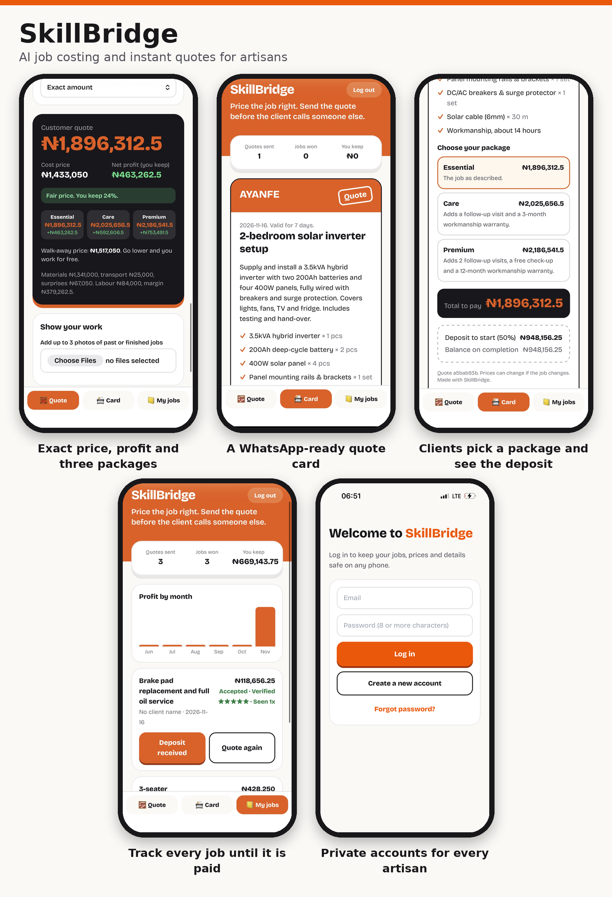
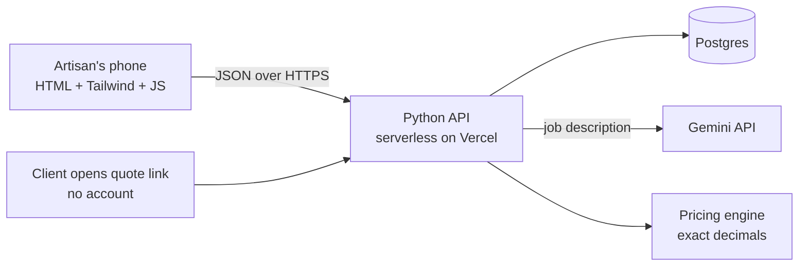

# SkillBridge

**AI job costing and instant quoting for artisans.** Mechanics, tailors, carpenters, solar installers and phone technicians describe a job in plain English or Pidgin, get an exact price, and send the client a professional quote on WhatsApp.

**Live demo:** [skillbridge-nine-theta.vercel.app](https://skillbridge-nine-theta.vercel.app)

> The source code is private. This repository documents what the product does and how it is built. I am happy to walk through the code on a call or share access with a hiring team on request.

## The problem

Many skilled workers quote from guesswork. They forget transport or surprise costs, underprice, and lose jobs to whoever replies first. SkillBridge turns "how much?" into a priced, itemised quote in under a minute.

## What it does

- **Describe a job, get a breakdown.** Type or speak a job in English or Pidgin, or tap a sample. An LLM drafts the materials list, labour hours and a client-friendly description.
- **Exact pricing.** All money maths runs in deterministic code, never in the AI. It shows cost price, customer quote, net profit and a walk-away price below which the artisan works for free.
- **Three packages.** Clients can choose Essential, Care or Premium (follow-up visits and warranty), so artisans can win bigger contracts.
- **WhatsApp-ready quote cards.** Itemised materials, deposit, bank details, an expiry date, and a direct chat to the client's number.
- **Client actions, no account needed.** Clients open a link, pick a package, accept the quote, and confirm finished work with a star rating.
- **Public portfolio page.** Artisans can share a page of client-confirmed jobs, with ratings and a photo. It never shows prices or client names.
- **Job pipeline.** Sent, accepted, deposit paid, paid in full. It also shows when a client has viewed a quote, warns before a quote expires, and charts profit by month.
- **A price book that learns.** Correct a material price once and it is reused on later estimates.
- **Private accounts.** Each artisan's jobs, prices and details are private to them.
- **Mobile first.** Built for phones and low data, with voice input, an installable web app, and an offline calculator fallback.

## How the pricing works (and why the AI never touches money)

The LLM proposes materials and hours. A deterministic engine does every calculation with exact decimal arithmetic, so there is no floating-point drift and no chance of an AI "arithmetic hallucination" on someone's livelihood.

Worked example (brake pads and oil service, 25% margin, 5% contingency, 50% deposit):

| | |
|---|---|
| Materials | N78,500 |
| Contingency (5%) | N3,925 |
| **Cost price** | **N82,425** |
| Labour (2.5 h x N5,000) | N12,500 |
| **Customer quote** | **N118,656.25** |
| **Net profit** | **N36,231.25** |
| Deposit / balance | N59,328.13 / N59,328.12 |

The deposit and balance always add up to the quote to the last kobo.

## Architecture

## Tech stack

Python · FastAPI · PostgreSQL (Neon) · Google Gemini API · HTML, Tailwind CSS and vanilla JavaScript · Vercel

## Engineering decisions

- **AI proposes, code calculates.** The model never produces a price. This keeps quotes explainable and testable.
- **Privacy by design.** Cost price, profit and client contact details are stripped on the server before anything reaches a public page.
- **Secure accounts.** Salted password hashing, signed session tokens, one-time recovery codes, and rate limiting on sign-up, login and AI calls.
- **Serverless and cheap to run.** Runs on free tiers, with a managed Postgres database and a graceful offline fallback.
- **Built and deployed end to end,** including the hosting setup, from a phone.

## Known limitations and roadmap

- "Verified" means the client confirmed through their private link. It does not prove who they are.
- Password reset uses a one-time recovery code. Email reset and phone-number login need an email or SMS provider.
- Online deposit payments are not built yet. They need a payment provider and a payout design.

## Author

Built by [Jimoh Ayanfeoluwa](https://www.linkedin.com/in/jimoh-ayanfeoluwa-b7b384243), an AI product builder based in Nigeria.
